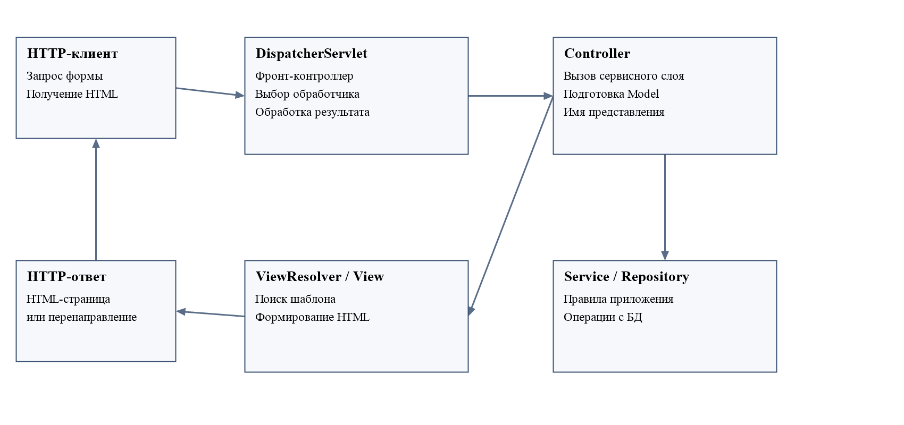
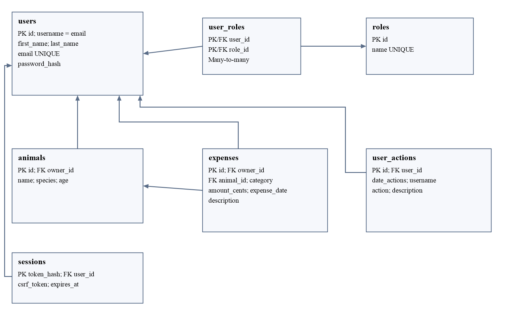
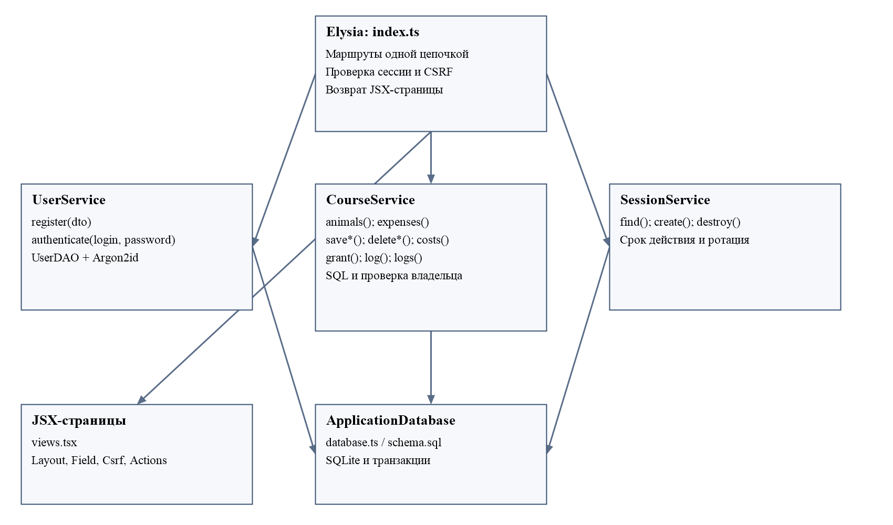
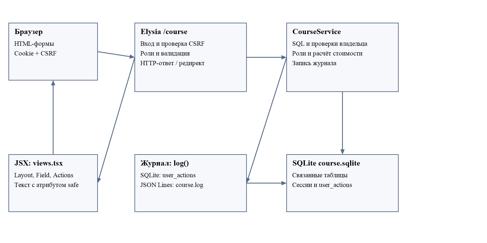

# Курсовой проект

Министерство науки и высшего образования Российской Федерации

Федеральное государственное автономное образовательное учреждение высшего образования

«Уральский федеральный университет имени первого Президента России Б. Н. Ельцина»

Институт радиоэлектроники и информационных технологий — РТФ

Центр ускоренного обучения

По дисциплине «Технологии программирования»

«Веб-приложение для учёта домашних животных и расходов на их содержание». Вариант 5

Работу выполнил: студент группы РИЗ-250213у

Романов Сергей Сергеевич

Екатеринбург, 2026

## СОДЕРЖАНИЕ

[АВТОСОДЕРЖАНИЕ]

## ОПРЕДЕЛЕНИЯ

| Термин | Определение в контексте проекта |
| --- | --- |
| Аутентификация | Проверка учётных данных и установление пользователя |
| Авторизация | Проверка права на просмотр или изменение конкретной записи |
| Сессия | Сохранённое на сервере состояние входа, определяемое случайной cookie |
| Владелец записи | Пользователь, которому принадлежит животное или расход |
| Аудит | Журнал действий пользователей с датой и описанием операции |
| ORM | Сопоставление объектов приложения со строками реляционных таблиц |
| DTO | Объект передачи данных с явно выбранным набором полей |

## ОБОЗНАЧЕНИЯ И СОКРАЩЕНИЯ

БД — база данных; СУБД — система управления базами данных; HTTP — протокол взаимодействия браузера и сервера; HTML — язык разметки; SQL — язык запросов к реляционной БД; CRUD — создание, чтение, изменение и удаление; MVC — Model–View–Controller; JPA — Jakarta Persistence; CSRF — подделка межсайтового запроса; JSONL — последовательность JSON-объектов, по одному в строке; PK — первичный ключ; FK — внешний ключ.

## ВВЕДЕНИЕ

Расходы на домашнее животное распределяются между кормлением, ветеринарными услугами, уходом и другими покупками. При хранении этих сведений в отдельных заметках трудно определить месячную сумму и сравнить категории. Дополнительная задача возникает при совместном использовании системы: одному пользователю достаточно просмотра, другому требуется изменение собственных записей, администратору — доступ ко всем данным.

Цель проекта — разработать веб-приложение «Мои питомцы», которое объединяет учёт животных, связанные расходы, расчёт стоимости содержания и контроль доступа. Объектом разработки является веб-приложение с файловой реляционной БД. Предмет разработки — организация связанных данных и проверка прав на операции с ними.

Для достижения цели необходимо спроектировать две предметные таблицы; реализовать вход и регистрацию; определить правила READ_ONLY, USER и ADMIN; создать формы списков и редактирования; обеспечить журналирование действий в БД и отдельном файле; разработать расчётную форму и мониторинг; проверить поведение приложения и описать решение.

Методическое пособие ориентировано на Java и Spring Boot. Практическая часть выполнена на стеке существующего репозитория: TypeScript, Bun, Elysia и SQLite. Теоретический раздел сохраняет предусмотренное пособием рассмотрение Java-технологий и сопоставляет их с реализацией. Курсовой проект находится в общей ветке main, выделен каталогом src/course, маршрутами /course и комментариями «Курсовая». Исходные лабораторные работы сохранены.

## 1 ОПИСАНИЕ ИСПОЛЬЗУЕМЫХ ТЕХНОЛОГИЙ

### 1.1 Существующие фреймворки Java

Фреймворк определяет общие механизмы приложения: создание компонентов, обработку HTTP, подключение данных и конфигурацию. Для серверной разработки на JVM можно рассмотреть Spring Boot, Quarkus и Micronaut. Сравнение составлено по официальным материалам проектов [1–3], а выбор для конкретной системы зависит от окружения и требований, а не только от перечня возможностей.

| Критерий | Spring Boot | Quarkus | Micronaut |
| --- | --- | --- | --- |
| Основная область | Приложения экосистемы Spring | Облачные приложения и контейнеры | Микросервисы и serverless |
| Открытый исходный код | Да | Да | Да |
| Организация компонентов | Контейнер Spring, автоматическая конфигурация | Расширения и обработка при сборке | Внедрение зависимостей с обработкой при компиляции |
| Работа с native image | Поддерживается соответствующими средствами | Одна из ключевых областей применения | Поддерживается |
| Практический фактор выбора | Совместимость со стеком Spring | Цели развёртывания и расширения | Модель компиляции и модульность |

Таблица характеризует подходы проектов, а не результаты измерения скорости. Для вывода о производительности потребовался бы отдельный эксперимент на одинаковой задаче и оборудовании. В данном проекте такой эксперимент не проводился.

### 1.2 Spring Boot

Spring Boot упрощает создание самостоятельных приложений Spring: предоставляет стартовые зависимости, автоматическую конфигурацию и средства запуска сервера. В учебном Java-проекте он объединяет Web, Security, Data JPA, шаблоны и диагностические средства [1]. При этом Spring Boot не заменяет SQL, модель данных и правила доступа: их всё равно определяет разработчик.

В реализованном приложении аналогичные обязанности распределены между Bun, Elysia и собственными сервисами. Bun выполняет TypeScript-код и предоставляет HTTP-среду, SQLite-драйвер, хеширование паролей и тестовый раннер. Elysia задаёт маршруты и последовательность обработчиков. Вход использует код ЛР8, а операции с животными, роли и журнал собраны в одном CourseService. Это позволяет перенести смысл задания на используемый стек и проверить каждую границу доступа отдельно.

### 1.3 Сравнение БД и способы доступа к данным

Для учебного приложения рассмотрены SQLite, H2 и PostgreSQL по их официальной документации [4–6]. Все три решения работают с реляционными данными, однако различаются способом встраивания и эксплуатации.

| Критерий | SQLite | H2 | PostgreSQL |
| --- | --- | --- | --- |
| Типичное размещение | Внутри процесса приложения | Встроенный либо серверный режим | Отдельный сервер |
| Хранение | Файл; возможна память | Файл либо память | Серверное хранилище |
| Связь с Java | Нужен подходящий драйвер | Реализована на Java, JDBC | JDBC-драйвер и серверное подключение |
| Настройка учебного запуска | Не требуется отдельный сервер | Удобна в JVM-проекте | Требуется настроить сервер и доступ |
| Подходящее применение | Локальные и небольшие приложения | Встраиваемые JVM-приложения и тесты | Многопользовательские серверные системы |

SQLite выбрана из-за простого локального запуска и встроенного драйвера Bun. Приложение использует один файл, транзакции, внешние ключи, проверки значений и индексы. Такой выбор достаточен для демонстрации задания. Для нагрузки с большим количеством конкурентных записей следовало бы отдельно оценить серверную СУБД [4].

В Java доступны прямой JDBC, Spring JdbcTemplate и подход ORM через JPA. JdbcTemplate уменьшает объём служебного JDBC-кода; Spring Data JPA добавляет репозиторный уровень поверх JPA [7, 8]. В проекте SQL явно записан в слоях доступа к данным и сервисах. Параметры передаются отдельно от текста запроса. Изменение предметных данных и запись аудита в БД объединены транзакцией.

### 1.4 Spring MVC и соответствие архитектуре проекта

Spring MVC использует DispatcherServlet как центральный обработчик запроса. Он организует поиск обработчика, вызов контроллера и работу с результатом. В варианте с серверными шаблонами контроллер подготавливает модель и выбирает представление, которое формирует HTML [9].



В курсовом проекте маршрутизацию выполняет Elysia. Входной запрос проходит проверку сессии, CSRF и прав. Обработчик вызывает сервис, получает данные и передаёт их в функцию шаблона. Ответом является HTML либо перенаправление. При успешном сохранении применяется Post/Redirect/Get: браузер переходит к списку через HTTP 303, и обновление списка не повторяет запись.

В модели содержатся животные, расходы, пользователи и результат расчёта; страницы написаны на JSX в views.tsx, а обработчики находятся в index.ts. Правила владельца и ролей проверяются до выполнения изменения и дополнительно учитываются при SQL-выборке.

### 1.5 Lombok: преимущества и ограничения

Lombok генерирует часть служебного Java-кода на основе аннотаций: методы доступа, конструкторы и другие элементы [10]. Это сокращает повторяющиеся объявления и делает простые модели компактнее. Однако при оценке подхода необходимо учитывать зависимость сборки и среды разработки от обработки аннотаций, а также необходимость понимать сгенерированное поведение.

Автоматическая генерация всех методов не заменяет проектирование сущности. Например, состав изменяемых полей следует определять по правилам приложения. В проекте TypeScript-интерфейсы задают структуру DTO и записей без генерации getter/setter. Поле владельца назначается на сервере; его нельзя изменить добавлением ownerId в форму. При работе с паролями используется отдельный тип учётных данных, который не передаётся в представления.

### 1.6 JPA и реализации ORM

Jakarta Persistence определяет стандарт сохранения Java-объектов и их отображения на реляционные данные [11]. Hibernate ORM и EclipseLink являются примерами решений этой области [12, 13]. JPA следует отличать от конкретной реализации и от Spring Data JPA, который предоставляет дополнительную абстракцию репозиториев.

| Подход | Польза | Что необходимо контролировать |
| --- | --- | --- |
| JPA / ORM | Работа с сущностями и связями, сокращение повторяющегося кода | Границы транзакций, загрузку связей, фактические запросы |
| Явный SQL | Видимые запросы и условия доступа, прямое управление выборкой | Согласованность SQL и типов, повторяющееся отображение строк |

Для двух предметных сущностей выбран явный SQL. Это позволяет непосредственно показать условие owner_id, ограничения внешнего ключа и хранение денежных сумм. Отношение пользователей и ролей «многие ко многим» реализовано таблицей user_roles, а отношение животного к расходам — внешним ключом animal_id.

### 1.7 Стек практической реализации

TypeScript задаёт типы Animal, Expense, User и Session. Bun выполняет приложение, тесты и работу с SQLite, а Bun.password используется для Argon2id-хешей [14, 15]. Elysia организует HTTP-маршруты и обработчики. Оформление хранится локально; браузеру не нужны внешние CDN для работы форм.

Отсутствие ORM не отменяет разделение ответственности. UserDAO получает учётные данные, SessionService управляет сессиями. Один CourseService выполняет операции с животными и расходами, добавляет роли и записывает журнал. Валидация HTTP-форм и отображение ошибок находятся в обработчиках и шаблонах.

## 2 ОПИСАНИЕ ЗАДАЧИ

### 2.1 Требования к веб-приложению

По варианту 5 необходимо реализовать список домашних животных и стоимость содержания: корм, ветеринарные услуги и другие расходы. В проекте выбраны связанные таблицы animals и expenses. Животное содержит кличку, вид и возраст. Каждый расход относится к одному животному, имеет категорию, сумму, дату и необязательное примечание.

| Требование методички | Реализация |
| --- | --- |
| Вход и главная | /course/login и /course |
| Списки двух таблиц | /course/animals и /course/expenses |
| Формы ввода двух таблиц | /course/animals/new и /course/expenses/new; общие формы редактирования |
| Просмотр логов | /course/logs |
| О приложении | /course/about, сведения о разработчике и назначении |
| Расчёт характеристик | /course/calculator, стоимость содержания за месяц |
| Добавление ролей | /course/roles, только ADMIN |
| Actuator | /course/actuator и методы health, info, metrics |
| Логи в отдельном файле | logs/course.log в формате JSON Lines |
| Действия в БД | user_actions с датой, пользователем и описанием |

Новый пользователь всегда получает READ_ONLY. USER получает доступ только к собственным предметным записям. ADMIN видит все данные и может изменять их и добавлять роли. Если у аккаунта несколько ролей, действует приоритет ADMIN, затем USER, затем READ_ONLY.

### 2.2 Структура базы данных

База хранится в testdb/course.sqlite и не совпадает с файлами лабораторных. Схема создаётся автоматически при первом обращении и сохраняет данные после перезапуска. Проверка внешних ключей включена. Секреты учётных записей и локальная БД исключены из Git.



| Таблица | Основные поля | Назначение |
| --- | --- | --- |
| users | id, first_name, last_name, email, username, password_hash | Учётные записи; username вычисляется из email |
| roles | id, name | READ_ONLY, USER, ADMIN |
| user_roles | user_id, role_id | Связи пользователей и ролей |
| sessions | token_hash, user_id, csrf_token, expires_at | Анонимные и авторизованные сессии |
| animals | id, owner_id, name, species, age | Животные и их владельцы |
| expenses | id, owner_id, animal_id, category, amount_cents, expense_date, description | Затраты на содержание |
| user_actions | id, date_actions, user_id, username, action, description | История действий |

Возраст — целое число от 0 до 100. Категории расходов ограничены значениями FOOD, VET, CARE и OTHER. Сумма хранится целым числом копеек, от 1 до 1 000 000 000: это соответствует диапазону от 0,01 до 10 000 000 рублей. Дата хранится в формате YYYY-MM-DD; существование календарной даты проверяется сервером. Примечание ограничено 200 символами.

Владелец записи соответствует создавшему её пользователю: owner_id берётся из сессии. USER может связать расход только со своим животным. Администратор может добавить свой расход к любому животному; автором расхода остаётся администратор, поэтому другой аккаунт USER не увидит эту запись. При редактировании владелец сохраняется. В чужом расходе ADMIN выбирает животное того же владельца, чтобы не раскрывать этому пользователю чужие записи через связь. Удаление животного с существующими расходами запрещено: сначала необходимо удалить или переназначить зависимые записи.

Для ролей используются составной первичный ключ user_roles и внешние ключи. Для быстрого ограничения выборок предусмотрены индексы по owner_id и animal_id; для журнала — по пользователю и идентификатору; для сессий — по сроку действия.

### 2.3 Классы и взаимодействие компонентов



ApplicationDatabase управляет соединением и схемой. UserDAO и UserService взяты из ЛР8: они находят пользователей и проверяют хеши паролей; для регистрации задана роль READ_ONLY. SessionService создаёт и удаляет сессии. В одном CourseService собраны методы animals и expenses для чтения, saveAnimal и saveExpense для сохранения, deleteAnimal и deleteExpense для удаления, costs для расчёта, grant для добавления роли, log и logs для журнала. Маршруты вызывают эти методы напрямую, без дополнительных классов ролей и аудита.

Контроллер не доверяет переданным идентификаторам. Сервис повторно проверяет доступность выбранной записи и связанного животного. Ошибки предметной области представлены CourseError с HTTP-статусом и понятным сообщением. Шаблоны получают подготовленные данные и экранируют пользовательский текст.

### 2.4 Востребованность Spring Boot

На 28 октября 2026 года рассмотрена небольшая качественная выборка: две вакансии работодателей на «Хабр Карьере» и одна на карьерном сайте Lamoda [16–18]. Сравнивались роль, область применения и сопутствующие навыки. Это наблюдение по трём объявлениям, а не оценка общего числа вакансий или доли технологии на рынке.

| Источник и дата объявления | Вакансия | Упоминание Spring Boot и сопутствующих навыков |
| --- | --- | --- |
| Хабр Карьера, 26.10.2026 | Уралсиб, эксперт-разработчик Java | Java 17+, Spring Boot, SQL, REST; разработка онлайн-банка |
| Хабр Карьера, 24.10.2026 | Лоция, Java Developer | Spring Boot и Spring Framework в навыках; Java 21, SQL, REST/API и Kafka в описании |
| Карьерный сайт Lamoda, 20.10.2026 | Senior Java developer | Java 17–21, Spring Boot, Hibernate, PostgreSQL, Kafka; складская система |

Примеры показывают применение Spring Boot в банковской системе, платформенной разработке и логистике. Во всех случаях нужны и общие серверные компетенции: работа с данными, тестирование, взаимодействие компонентов. Поэтому изучение контроллеров, транзакций, авторизации и аудита сохраняет практическую ценность при реализации учебной задачи на другом языке.

Зарплатные оценки «похожие специалисты получают» не использованы как зарплаты рассматриваемых вакансий. Количественное сравнение с HH.ru не выполнялось: автоматические запросы к его API вернули HTTP 403. Из этого не делается вывод об отсутствии вакансий. Ссылки и дата обращения приведены в списке источников, поскольку объявления могут изменяться и закрываться.

## 3 РАЗРАБОТКА ВЕБ-ПРИЛОЖЕНИЯ

### 3.1 Структура проекта

```text
src/course/
  index.ts       — маршруты, проверка входа, CSRF и валидация
  database.ts    — отдельная БД курсового проекта
  schema.sql     — таблицы, связи и ограничения
  model.ts       — Animal, Expense, категории и денежные значения
  service.ts     — один CourseService: SQL, расчёт, роли и журнал
  views.tsx      — JSX-страницы и общие компоненты Layout и Field
scripts/course-admin.ts   — назначение первого администратора
tests/course.test.ts      — интеграционные проверки
```

Всего в src/course шесть файлов. Начать разбор удобно с index.ts: запрос проходит проверку входа, вызывает метод CourseService и возвращает JSX-страницу из views.tsx. Вложенные группы маршрутов не используются: обработчики записаны одной последовательной цепочкой. Общий src/app.ts подключает новый этап по префиксу /course. Параметры COURSE_DATABASE_PATH и COURSE_LOG_PATH задают файл БД и журнал. Создание соединения остаётся ленивым: вызов старых API не открывает БД курсового проекта. Все соединения закрываются при остановке HTTP-сервера.

### 3.2 Решение поставленной задачи



После регистрации пользователь может просматривать животных и расходы и выполнять расчёт стоимости. Для ведения собственных данных администратор добавляет USER. Эта роль ограничивает и список, и прямой доступ к записи по id. Нельзя обойти проверку изменением адреса формы, скрытого поля ownerId или идентификатора животного в расходе.

| Операция | READ_ONLY | USER | ADMIN |
| --- | --- | --- | --- |
| Просмотр предметных списков | Все записи, только чтение | Только собственные | Все |
| Создание и изменение | Запрещено | Собственные записи | Все записи |
| Удаление | Запрещено | Собственные записи | Все записи |
| Расчёт стоимости | По доступным животным | По собственным животным | По всем животным |
| Журнал | Собственные действия | Собственные действия | Общий журнал |
| Добавление ролей | Запрещено | Запрещено | USER или ADMIN |
| Мониторинг | Запрещено | Запрещено | Разрешено |

Публичная регистрация не позволяет выбрать роль. Первый администратор назначается локальной командой существующему аккаунту. Это решает начальную настройку без общего пароля и без автоматической выдачи ADMIN первому посетителю. Команда повторяема и записывает назначение в аудит.

### 3.3 Реализация аутентификации, операций и расчёта

Пароль хешируется алгоритмом Argon2id. В cookie course_session находится случайный токен, в БД — его SHA-256. Сессия действует 8 часов, меняется при входе и удаляется при выходе. Cookie имеет HttpOnly, SameSite=Lax и Path=/course; при HTTPS устанавливается Secure. Рекомендации по случайным токенам, смене сессии и cookie рассматриваются в материалах OWASP [19].

Все POST, включая вход, регистрацию, калькулятор и выдачу ролей, проверяют CSRF-токен текущей сессии. GET не удаляет записи и не выполняет выход. Заголовки ответов ограничивают кеширование и встраивание страницы. Ошибки внутренней инфраструктуры не выводят путь файла и SQL в HTML.

Для страниц используется официальный HTML-плагин Elysia [21]. В tsconfig.json заданы jsx: react, jsxFactory: Html.createElement и jsxFragmentFactory: Html.Fragment. Плагин html() устанавливает Content-Type и добавляет doctype; страницы возвращаются прямо из обработчиков. JSX здесь формирует HTML на сервере, React в браузере не используется.

Пример строки таблицы из views.tsx:

```tsx
{rows.map(row => <tr>
    <td safe>{row.name}</td>
    <td safe>{row.species}</td>
    <td>{row.age}</td>
    <td><Actions base="/course/animals" id={row.id} session={session} /></td>
</tr>)}
```

Атрибут safe экранирует динамический текст. Для повторяющихся частей используются только небольшие JSX-компоненты: Layout для страницы, Field для подписанного поля, Csrf для скрытого токена и Actions для кнопок. HTML не собирается длинными строками и вручную не склеивается.

Форма животного содержит кличку, вид и возраст. Форма расхода содержит животное, категорию, сумму, дату и примечание. Для ADMIN при редактировании чужого расхода список животных ограничивается тем же владельцем, чтобы сохранялась согласованность. Ошибочная форма возвращает введённые значения и сообщение; после успешного сохранения сервер отвечает 303 и возвращает пользователя к списку.

Для READ_ONLY изменение отклоняется до записи. Для USER SQL учитывает owner_id. Условие фильтрации применяется на сервере и не зависит от скрытия кнопки:

```typescript
const ownOnly = (user: User) =>
    !isAdmin(user) && user.roles.includes('USER')
```

Денежные значения вводятся в рублях с точкой или запятой и максимум двумя знаками после разделителя. Значение разбирается на рубли и копейки, затем сохраняется целым числом. Например, 0,10 и 0,20 превращаются в 10 и 20 копеек; итог — 30 копеек. Нельзя ввести отрицательную сумму, ноль, экспоненциальную запись или третью десятичную цифру.

Для животного a и месяца m стоимость определяется суммой amount_cents всех доступных расходов этого животного с датой в месяце m. Дополнительно выводятся суммы категорий и среднее за календарный день:

```text
monthlyTotal = sum(amount_cents)
categoryTotal[k] = sum(amount_cents where category = k)
dailyAverage = round(monthlyTotal / daysInSelectedMonth)
```

Для октября с расходами 144,10 руб. на корм и 72,20 руб. на ветеринара итог составляет 216,30 руб., среднее за 31 день — 6,98 руб. Запись из ноября не входит в октябрьский результат. Для февраля 2024 года учитываются 29 дней. Если расходов нет, выводится нулевая сумма, а не ошибка.

Действия регистрации, входа, выхода, просмотра страниц, CRUD, расчёта, выдачи ролей и отклонения CSRF записываются в журнал. Пароли, cookie и защитные токены в журнал не включаются. Формат файла — JSON Lines, поэтому перевод строки в пользовательском значении не создаёт поддельную строку журнала.

CRUD и соответствующий аудит в БД выполняются в одной SQLite-транзакции. Если запись файлового журнала не удалась в ходе операции, изменение БД откатывается; это проверено тестом. Файл и SQLite не являются общей распределённой транзакцией: при аварийном завершении процесса между операциями возможна необходимость сверки файла и БД. Для учебного локального приложения выбран синхронный файловый аудит.

Журнал показывает по 100 записей с переходом к более ранним. Для обычного пользователя фильтр user_id применяется в SQL. ADMIN получает общую историю. Время хранится в ISO UTC, а на форме выводится по Екатеринбургу (UTC+5).

Мониторинг повторяет назначение Actuator средствами текущего стека: /course/actuator/health выполняет SELECT 1; info возвращает имя приложения, вариант 5 и версию Bun; metrics — время работы процесса, RSS-память и число запросов к новому этапу. Все эти методы требуют ADMIN.

### 3.4 Результаты проверки приложения

Для курсового проекта подготовлены 22 автоматические проверки. Они запускают настоящие HTTP-серверы и используют временные файловые БД и журналы. Проверяются три роли, запрет доступа к чужим id, связь расходов с животным, CRUD, расчёт в копейках, реальные даты и високосный год, журналирование, CSRF, сессии, перезапуск и назначение первого администратора.

| Проверка | Ожидаемое поведение |
| --- | --- |
| Аноним открывает защищённый список | 303 на форму входа |
| READ_ONLY отправляет сохранение | 403 без изменения данных |
| USER обращается к чужой записи | 404, запись не раскрывается |
| ADMIN изменяет чужую запись | 303, владелец сохраняется |
| Удаление животного с расходами | 409 с понятным объяснением |
| Ошибочные сумма, дата или возраст | 400 с сохранённой формой |
| Калькулятор | Сумма только выбранного месяца и животного |
| Выдача роли | Проверка ADMIN, изменение действует в текущей сессии |
| Ошибка записи файлового аудита при CRUD | 500, откат предметной записи и аудита БД |
| Перезапуск | Данные, роли, сессии и журнал сохраняются |

Скриншоты интерфейса и DBeaver добавляются автором самостоятельно. Приведённые выше схемы построены программно и описывают проект, они не являются скриншотами работающего интерфейса.

[Место для скриншота 1: главная страница «Мои питомцы».]

[Место для скриншота 2: регистрация и сообщение об успешном создании аккаунта.]

[Место для скриншота 3: форма входа.]

[Место для скриншота 4: список животных с READ_ONLY без кнопок изменения.]

[Место для скриншота 5: форма животного и сохранённая запись с ролью USER.]

[Место для скриншота 6: форма расхода и список расходов.]

[Место для скриншота 7: расчёт месячной стоимости с категориями.]

[Место для скриншота 8: журнал действий.]

[Место для скриншота 9: форма выдачи ролей у ADMIN.]

[Место для скриншота 10: таблицы и связи БД в DBeaver.]

[Место для скриншота 11: сведения health, info и metrics.]

[Место для скриншота 12: страница «О приложении».]

### 3.5 Запуск и воспроизведение проверки

Из корня репозитория:

```powershell
bun.cmd install
bun.cmd run start
```

Открыть http://localhost:8082/course/register и создать свой аккаунт. Для первого администратора во втором терминале выполнить команду с email созданного аккаунта:

```powershell
bun.cmd run course:admin admin@example.test
```

Готового аккаунта admin@example.test нет: в команде необходимо указать свой зарегистрированный email. Далее войти в /course/login. Для проверки USER и READ_ONLY зарегистрировать ещё два аккаунта. На странице /course/roles выдать USER одному из них, второй оставить READ_ONLY. Переключая аккаунты, проверить матрицу доступа.

Для проверки расчёта создать животное, добавить два расхода в одном месяце и один в другом, затем открыть калькулятор. Для DBeaver выбрать подключение SQLite к файлу курсовой. Схема и роли создаются автоматически, предварительный SQL не требуется.

```powershell
$env:COURSE_DATABASE_PATH = 'testdb/my-course.sqlite'
$env:COURSE_LOG_PATH = 'logs/my-course.log'
bun.cmd run start
```

При назначении администратора использовать те же переменные. Файл курсовой должен отличаться от DATABASE_PATH и LAB8_DATABASE_PATH. Сервис 2 для курсовой не нужен.

```powershell
bun.cmd test tests/course.test.ts
bun.cmd test
bun.cmd run typecheck
python scripts/course-report.py
```

После добавления собственных изображений в Word обновить содержание и номера страниц. Схемы можно пересоздать командой powershell -NoProfile -ExecutionPolicy Bypass -File scripts/course-diagrams.ps1; изменение общей политики выполнения Windows не требуется.

## ЗАКЛЮЧЕНИЕ

Разработано веб-приложение «Мои питомцы» по варианту 5. Созданы связанные таблицы животных и расходов, формы ввода и списков, расчёт месячной стоимости содержания с разбивкой по категориям. Реализованы регистрация с READ_ONLY, работа USER только со своими данными, полный доступ ADMIN и административная форма выдачи ролей. Добавлены журнал действий в SQLite и отдельном файле, мониторинг и страница о разработчике.

Автоматические проверки охватывают предметные операции, права на конкретные записи, денежные значения и календарные даты, сессии, аудит и сохранение данных. Проект продолжает подход лабораторных: один репозиторий и ветка, явные пометки этапов и адаптация Java-задания к TypeScript, Bun и Elysia.

Возможные дальнейшие улучшения — фильтры списков по периоду и категории, экспорт отчёта в CSV и сверка файлового аудита с БД после аварийного завершения. Они не включены в обязательный объём реализации.

## СПИСОК ИСПОЛЬЗОВАННЫХ ИСТОЧНИКОВ

Дата обращения к электронным источникам: 28.10.2026. Теоретические положения изложены своими словами; схемы отражают реализацию автора.

1. Spring Boot. Официальная страница проекта: https://spring.io/projects/spring-boot/
2. Quarkus. Официальная страница: https://quarkus.io/
3. Micronaut Framework. Официальная страница: https://micronaut.io/
4. SQLite. Appropriate Uses For SQLite: https://www.sqlite.org/whentouse.html
5. H2 Database. Features: https://www.h2database.com/html/features.html
6. PostgreSQL. About: https://www.postgresql.org/about/
7. Spring Framework. Data Access with JDBC: https://docs.spring.io/spring-framework/reference/data-access/jdbc.html
8. Spring Data JPA. Reference: https://docs.spring.io/spring-data/jpa/reference/
9. Spring Framework. DispatcherServlet: https://docs.spring.io/spring-framework/reference/web/webmvc/mvc-servlet.html
10. Project Lombok. Features: https://projectlombok.org/features/
11. Jakarta Persistence. Specification: https://jakarta.ee/specifications/persistence/
12. Hibernate ORM. Официальная страница: https://hibernate.org/orm/
13. EclipseLink. Официальная страница: https://eclipse.dev/eclipselink/
14. Bun. Hashing: https://bun.com/docs/runtime/hashing
15. Elysia. Handler: https://elysiajs.com/essential/handler
16. Хабр Карьера. Уралсиб, «Эксперт-разработчик Java»: https://career.habr.com/vacancies/1000169150
17. Хабр Карьера. Лоция, «Java Developer»: https://career.habr.com/vacancies/1000165261
18. Lamoda. Senior Java developer: https://job.lamoda.ru/vacancies/moskva/java-developer--2833
19. OWASP. Session Management Cheat Sheet: https://cheatsheetseries.owasp.org/cheatsheets/Session_Management_Cheat_Sheet.html
20. Учебно-методическое пособие «Курсовое проектирование SpringBoot (2).docx», каталог labs данного репозитория.
21. Elysia. HTML Plugin, JSX: https://elysiajs.com/plugins/html#jsx

## ПРИЛОЖЕНИЕ 1. РЕПОЗИТОРИЙ И ФРАГМЕНТЫ КОДА

Репозиторий: https://github.com/rssXX/programming-3-semester

Ветка main; основной код в src/course. Код предыдущих лабораторных доступен по прежним адресам.

Фрагмент назначения владельца нового расхода:

```typescript
const animal = this.animal(user, data.animalId)
const ownerId = old?.ownerId ?? user.id
if (animal.ownerId !== ownerId &&
    !(isAdmin(user) && ownerId === user.id)) {
    throw new CourseError(400,
        'Выберите животное того же владельца, что и расход')
}
```

Фрагмент параметризованной выборки животных с проверкой владельца:

```sql
SELECT id, owner_id AS ownerId, name, species, age
FROM animals
WHERE id = ? AND (? = 0 OR owner_id = ?);
```

Фрагмент расчёта стоимости:

```typescript
let totalCents = 0
for (const expense of this.expenses(user)) {
    if (expense.animalId !== animalId) continue
    if (!expense.expenseDate.startsWith(month + '-')) continue
    totalCents += expense.amountCents
}
const [year, selectedMonth] = month.split('-').map(Number)
const days = new Date(Date.UTC(year, selectedMonth, 0)).getUTCDate()
const dailyCents = Math.round(totalCents / days)
```

Фрагмент выдачи роли:

```typescript
requireAdmin(actor)
if (role !== 'USER' && role !== 'ADMIN') {
    throw new CourseError(400, 'Можно добавить только USER или ADMIN')
}
```

## ПРИЛОЖЕНИЕ 2. ЗАКЛЮЧЕНИЕ ОНЛАЙН-ПРОВЕРКИ НА АНТИПЛАГИАТ

Онлайн-проверка не проводилась. Процент оригинальности и заключение не заявляются. После завершения текста и добавления собственных скриншотов автору необходимо выполнить проверку в требуемой учебным заведением системе и вставить полученное заключение.

[Место для подлинного заключения онлайн-проверки: название системы, дата, идентификатор отчёта и результат.]
